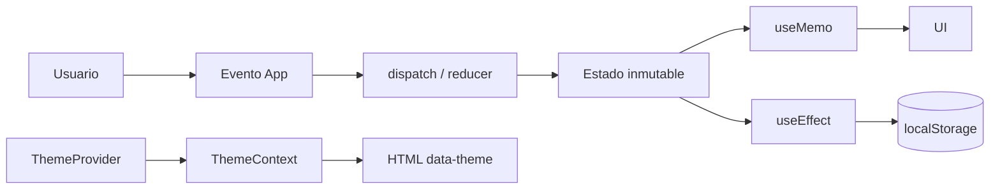

# Dashboard de Gestión de Tareas — Semana 07, Parte 2

Aplicación académica con React y Vite para practicar estado complejo, Hooks y renderizado eficiente.

## Ejecución

`npm install` · `npm run dev` · `npm run build` · `npm run lint`

## Estructura

```text
src/
├── components/TaskList.jsx
├── contexts/ThemeContext.jsx
├── hooks/useLocalStorage.js
├── hooks/useTasksReducer.js
├── App.jsx
├── App.css
└── index.css
```

## Funcionalidades

Crear, completar, eliminar, buscar, filtrar y ordenar tareas; estadísticas; modo claro/oscuro responsive; persistencia de tareas y tema.

## Hooks

- `useReducer` en `App.jsx`: coordina `ADD`, `REMOVE`, `TOGGLE`, `FILTER` y `SORT` mediante un reducer puro e inmutable.
- `useContext`: `ThemeContext` comparte tema y `toggleTheme` sin prop drilling.
- `useEffect`: persiste datos, aplica el tema y limpia el listener de teclado de `TaskList`.
- `useMemo`: calcula estadísticas y lista filtrada/ordenada con dependencias explícitas.
- `useCallback`: estabiliza acciones pasadas al `TaskList` memorizado.
- `useRef`: enfoca un input sin render adicional; Escape restaura el foco.
- `useLocalStorage`: hook reutilizable que serializa valores y controla errores de lectura/escritura.

`useReducer` agrupa transiciones relacionadas en vez de dispersarlas entre varios `useState`; el estado de UI simple sigue usando `useState`.

## Flujo de estado



Las claves `dashboard-tasks` y `dashboard-theme` permiten recuperar preferencias después de recargar. El efecto de `TaskList` elimina su listener con `removeEventListener` al desmontarse.

## Validación y rendimiento

Ejecute `npm run lint` y `npm run build` antes de entregar. Para medir realmente con React DevTools Profiler: abra **Profiler**, grabe una interacción (agregar, filtrar o completar) y compare los commits. No se reportan mediciones de Profiler porque requieren una sesión manual.
